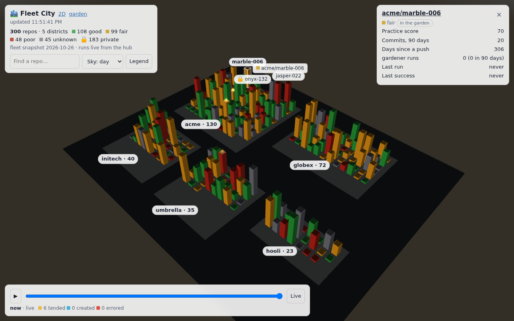
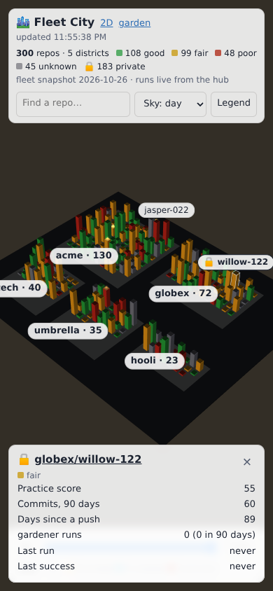
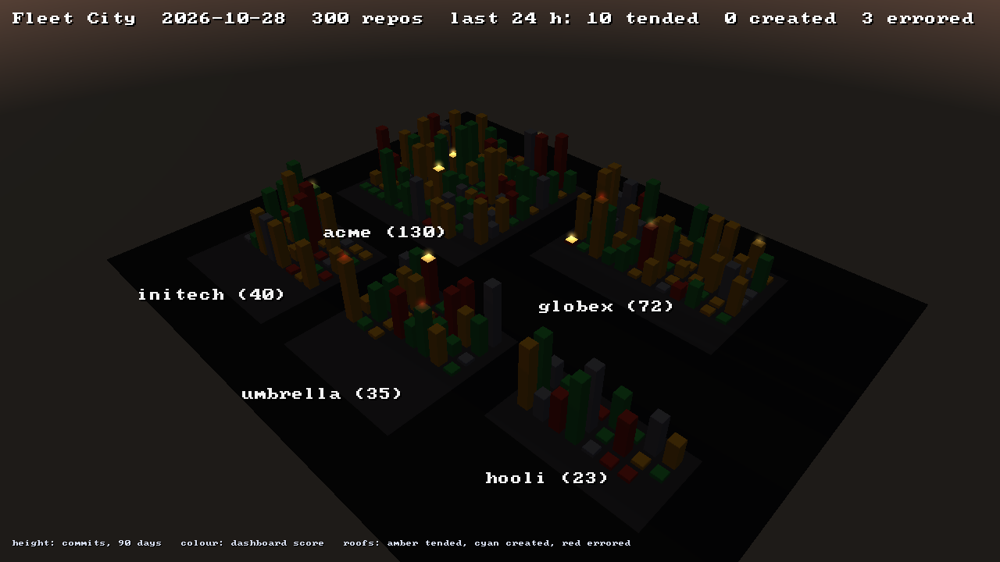

# Sharing run history across devices: the hub

gardener keeps its run history in a local SQLite file on each device that
runs it. When more than one device tends the same fleet (a desktop and a
phone, say), each one's dashboard, `gardener status`, and spend figures see
only that device's runs.

The **hub** is optional. It is one more gardener process (`gardener hub
serve`). Every configured device pushes its runs to it, and it serves the
normal dashboard over the combined history, with a Device column, at a URL
you choose.

It **adds to local storage and replaces none of it**:

- With no hub configured, gardener behaves exactly as it always has.
- With a hub configured, each device still writes its local store
  **first**. The push is a copy made after that. If the hub is down or the
  device is offline, runs wait in the local outbox (`pushed_at IS NULL`)
  and go with the next push. A dispatch never fails, blocks, or loses its
  record because of the hub.
- Unset `GARDENER_HUB_URL` to go back to local-only. Nothing is lost,
  because the local store was never not being written.

The design and the alternatives it was chosen over are in RFC 0007 in the
maintainer's RFC repository.

## Setting up a hub

The hub needs the gardener package and nothing else (stdlib only). It
refuses to start without at least one operator credential, so it can
never serve the history anonymously.

```bash
# 1. One device token per device. Run anywhere; nothing is stored.
gardener hub token --device box
gardener hub token --device phone
#    Each prints the token (it goes on that device) and a
#    `name:sha256` entry (it goes on the hub).

# 2. An operator credential for the browser: hex sha256 of "user:password".
printf '%s' 'dan:a long passphrase' | sha256sum

# 3. Run it.
export GARDENER_HUB_DEVICE_TOKENS='box:<digest>,phone:<digest>'
export GARDENER_HUB_OPERATOR_BASIC_SHA256='<digest from step 2>'
gardener hub serve --host 0.0.0.0 --port 8765 --data-dir /var/lib/gardener-hub
```

### In a container

The repo's `Dockerfile` builds an image that runs only the hub:
`python:3.12-slim`, a non-root user, the store in the `/data` volume
(`/data/hub/gardener.sqlite3`), and a `HEALTHCHECK` on `/healthz`. Pass the
settings below as environment variables:

```bash
docker build -t gardener-hub .
docker run -d --name gardener-hub -p 127.0.0.1:8765:8765 -v gardener-hub-data:/data \
  -e GARDENER_HUB_DEVICE_TOKENS='box:<digest>' \
  -e GARDENER_HUB_OPERATOR_BASIC_SHA256='<digest>' gardener-hub
```

With no operator credential, the container exits with status 2 instead of
serving. Measured on a 2-vCPU Linode, it idled at about 16 MiB after twenty
dashboard polls, so a 64–128 MiB limit is plenty.

Back up the store with SQLite's online backup, not a file copy (the store
is in WAL mode):

```bash
docker exec gardener-hub python -c "import sqlite3; s=sqlite3.connect('/data/hub/gardener.sqlite3'); d=sqlite3.connect('/data/hub/backup.sqlite3'); s.backup(d)"
```

Put TLS in front of it (a reverse proxy) before exposing it beyond
localhost. Device tokens and the operator password travel in headers.

| Hub setting (environment) | Meaning |
|---|---|
| `GARDENER_HUB_DEVICE_TOKENS` | Comma-separated `device:sha256hex(token)`. Every row a token pushes is stored under that token's device name, so one device's token can't write rows that look like another's. |
| `GARDENER_HUB_OPERATOR_BASIC_SHA256` | Hex sha256 of `user:password`, for HTTP basic auth on the dashboard and API. |
| `GARDENER_HUB_USERAUTH_URL` | Optional. Base URL of a [UserAuth](https://github.com/Preponderous-Software/UserAuth) service. Enables a `/login` page. |
| `GARDENER_HUB_OPERATORS` | Required with `GARDENER_HUB_USERAUTH_URL`: comma-separated usernames allowed to sign in. UserAuth registration is open, so this list is the authorisation. |

Either operator mode is enough on its own, and both can be enabled
together. UserAuth sign-in stores the access token in an `HttpOnly;
Secure; SameSite=Strict` cookie. Each session is re-checked against
UserAuth's `/session/validate` at most once a minute, so signing out (or
revoking the session in UserAuth) takes effect within a minute. The
session lasts as long as UserAuth's access token does; there is no
refresh.

## Configuring a device

On each device, put this in `~/.local/state/gardener/hub.env` (or export
the same names; the environment wins):

```
GARDENER_HUB_URL=https://gardener.example.com
GARDENER_HUB_TOKEN=<this device's token from `gardener hub token`>
```

The hub shows the device under the name its token was minted for
(`gardener hub token --device phone`), and ignores the name the device
recorded locally. The local name is the hostname unless
`GARDENER_DEVICE_NAME` is set (the setting alert footers use, see
docs/ALERTING.md), and it can change over a device's life. Then push the
device's existing history once:

```bash
gardener hub sync
```

`gardener hub status` shows the device's settings and how many runs are
still queued, then asks the hub (one request) how many runs it holds under
this device's token name. It prints a match, or `MISMATCH` and exits 1, so
it is the per-device count check in one command. With the hub unreachable
it says so, and the local lines still answer. `sync` is safe to repeat. Every run carries a `run_uuid`, and the hub
ignores a uuid it already holds. After that, every recorded run pushes the
outbox automatically. On the dispatch path that push is bounded (5 s per
request, 20 s in total). A longer backlog is left for the next run or the
next `gardener hub sync`.

### Live heartbeats

While a dispatching command (`align`, `tend`, `overnight`) runs, a device
with a hub also sends it a **heartbeat**: a small snapshot of what it is
doing now (repos in flight, the batch, the overnight budget, and each
slot's phase, idle time, stalled flag and whether a rate limit was seen).
It sends one at the start, one every `GARDENER_HUB_HEARTBEAT_SECONDS`
(default 60; `0` turns them off), and a final one when the command exits.
`gardener hub status` shows the setting. On a phone, set it slower to save
battery and data:

```
GARDENER_HUB_HEARTBEAT_SECONDS=300
```

A heartbeat carries **no log lines, tool inputs, model text, or local
paths**, only structured fields, and the hub drops any field it doesn't
name. A failed beat is dropped, not queued (the next one replaces it), and
failures back off up to 10 minutes with one `NOTE` per session. A hub
without the route answers 404, and the device stops heartbeating for that
session, so upgrading devices before the hub is harmless. The design is RFC
0010.

## What the hub shows

| Panel | On the hub |
|---|---|
| Latest session, failures, per-night history, Recent runs | Combined across every device, ordered by timestamp. Recent runs gains a Device column. |
| Garden view | The union of every device's garden and merge allow-list, as each device last pushed them. These lists are display-only on the hub: they are never sent back to a device, and each device's own lists stay its own. |
| Currently tending, in flight | From each device's latest heartbeat (see "Live heartbeats"). Each repo is tagged with its device. A **stale** device's repos (no beat for 3 of its intervals) are shown greyed and aren't counted in "in flight", because it may have stopped. |
| Overnight budget and batch | One block per device under Latest session: **live** shows the device's budget and batch bars and "updated Ns ago"; **stale** shows the same greyed, with "last heard N min ago, may have stopped"; **idle** (ended, or unheard for 50 min) is one line. Age is measured on the hub's clock. |
| 3D garden (`/3d`) | The same combined garden as the garden view, with one gardener per device that has sent a heartbeat: named by its token, tending the repo its session is on or resting by the shed, grey-labelled when stale. |
| Fleet City (`/city`) | Every repository the hub knows of as a building in a 3D city, one district per owner; see [Fleet City](#fleet-city). Operator only, like every page here. |
| Garden cycle bar, live log, `/live` | Not available: they read a device's cursor file, log text and transcripts, which never leave it. The page doesn't render them. Open the dashboard on the dispatching device for those. |

## API

Devices use these endpoints. Everything except `/healthz` needs a credential.

| Endpoint | Who | What |
|---|---|---|
| `GET /healthz` | anyone | `ok`, no data |
| `POST /api/v1/runs` | device token | Body `{"runs": [...], "garden"?, "merge_allowlist"?}`, at most 500 runs. Answers `{"held": [uuid, ...]}`, listing every uuid from the batch the hub now holds. A row with an unknown `outcome` or a malformed uuid, repo, or timestamp refuses the whole batch with a 400 naming the field; the device keeps it queued. |
| `GET /api/v1/runs?repo=&limit=` | device token or operator | Newest runs across devices (`gardener status --all-devices`) |
| `GET /api/v1/latest-success?repo=&mode=` | device token or operator | When `repo` last recorded a successful `mode` run on any device. `tend`'s orphaned-PR check asks this before continuing a marked PR, so a PR one device handed off isn't taken for interrupted work on another (see [Orphaned-PR check](#orphaned-pr-check)). |
| `POST /api/v1/heartbeat` | device token | A live-state snapshot (see "Live heartbeats"), at most 16 KiB. The hub keeps only the latest per device, filed under the token's name, and ignores a beat older than the stored one for the same session. An unknown slot phase or a malformed field gets a 400 naming it. |
| `GET /api/v1/devices` | device token or operator | Each device's run count, newest run, seconds since it (`quiet` past 36 h), and latest session (`all_errors` when every run in it errored); `you` is the calling token's device name, or null for an operator. `gardener hub status` reads this. |
| `GET /`, `GET /api/status` | operator | The dashboard |
| `GET /3d`, `/3d/garden3d.js`, `/3d/garden3d.wasm`, `/3d/strata-kit.js`, `/3d/strata-loader.js` | operator | The 3D garden (see the dashboard docs' "The 3D garden"), over the same `/api/status` |
| `GET /city`, `/city/city.js`, `/city/city.wasm`, `/city/strata-kit.js`, `/city/strata-loader.js` | operator | Fleet City (see below). A signed-out browser is sent to `/login` |
| `GET /api/city?nights=` | operator | Fleet City's data: the laid-out city, each repository's numbers and the run events of the last `nights` nights (default 14, at most 60). Never served to a device token |

## Watching the devices

A device can't report that its nightly job stopped running; only
something off the device can see that nothing new arrived. The hub
answers that from its store, with two commands meant to run where the hub
runs (for the container, `docker exec gardener-hub gardener hub ...`):

| Command | What it prints |
|---|---|
| `gardener hub devices [--json] [--data-dir D]` | Per device: run count, newest run, and latest session, flagged `QUIET` when no run has arrived in 36 h and `ALL-ERRORS` when every run in the latest session errored. A device that has never pushed isn't listed. |
| `gardener hub digest [--hours N] [--data-dir D]` | A short plain-text summary of the last N hours (default 24): per device runs, successes, errors, spend, and the repos that errored, plus any quiet device. |
| `gardener hub city-still --out F.png [--hours N] [--width W --height H] [--data-dir D]` | Fleet City drawn headless to a PNG, every roof lit that a run touched in the last N hours, and one line of counts. Exits 2 when Strata isn't available (see [Fleet City](#fleet-city)). The picture shows the whole fleet, so it goes only where the dashboard itself could. |

Neither sends anything itself. Alerting and posting are the deployment's
job; the reference deployment calls both from its box-side health monitor.

## Fleet City





*A synthetic fleet (`tests/city_fixture.py`); no real repository is in any picture here.*

`/city` draws every repository the hub knows of as a building in a city
(Stephenson-Software RFC 0026): one district per owner, height for
activity, colour for health, and each run lighting its repository's roof,
fading over six hours. The timeline at the bottom replays the last two
weeks of nights; **Live** follows the clock, with a beacon over each
repository a device is tending right now (its latest heartbeat). Tap or
click a building for its card. It is the hub's own data, so like the rest
of the hub it is behind the operator sign-in, and so is `/api/city`.

What the city holds depends on one optional file:

| | Without `city.json` | With `city.json` in the data directory |
|---|---|---|
| Buildings | Repositories with a run on the hub, or in a device's garden | Also every repository in the snapshot |
| Height | gardener runs in the last 90 days (log) | Commits on the default branch in 90 days (log); else days since the last push |
| Colour | gardener's last success: under 3 days, under 10, older or never | The dashboard's practice-score bands: 80+, 50–79, under 50 |
| Plot order | First run gardener made on it | Creation date |

`city.json` is the snapshot the Fleet City builder writes (RFC 0026 §1,
schema 1). Copy it into the hub's data directory (`/data/hub/city.json` in
the container) and the next poll uses it; a file that doesn't parse is
ignored with one line on stderr. Only owner, name, visibility, fork,
creation date, score, 90-day commits and days since a push are read from
it. It names private repositories, which is why it stays on the hub and
never in this repository: the tests and the pictures in these docs use a
synthetic fleet (`tests/city_fixture.py`).

The renderer is `fleetcity/main.cpp`, built by `fleetcity/build.sh`
(emsdk 6.0.11 and Strata v0.6.0's WebAssembly release, SHA-256 pinned)
into the committed `gardener/web/city.{js,wasm}`; CI's `fleetcity` job
rebuilds them and fails on any difference. Each district is one mesh for
the bodies and one unlit mesh for the roofs, a per-triangle tag table maps
a ray-cast hit back to its repository, and colours are two palette
textures, so a timelapse frame rewrites one texture and no geometry.

The shell around the city is the Strata web kit, the same vendored copy in
`strata-kit/` that `/3d` builds on (see the dashboard docs' "The 3D
garden"), so the two pages load, size, step quality, orbit and place labels
the same way: the loading screen shows real download progress and a
browser without WebGL 2 gets a message and a link to the 2D dashboard;
quality steps down when frames are slow, pixel density first and then
shadows; `?quality=0|1|2`, `?fps=1` and `?drive=1` work as on `/3d`; and a
lost WebGL context is rebuilt in place (the city and its palettes are
uploaded again). Only a context lost twice in a minute, or not back in 5 s,
ends in a notice with a reload link. The page keeps its own timeline,
beacons, cards, search and legend.

**The nightly still.** `gardener hub city-still` draws the same layout
with Strata's Python binding on Mesa's software renderer (EGL, no
display), labels the districts only, never a repository, and writes a
PNG. It needs the Linux library and the binding, both SHA-pinned:



`fleetcity/fetch-strata-python.sh DIR` fetches them, then set
`GARDENER_STRATA_LIB=DIR/libstrata-0.6.0-linux-x64.so` and
`GARDENER_STRATA_PYTHON=DIR/python`. The container image does this at
build time and installs `libegl1` and `libgl1-mesa-dri`. Posting the
picture is the deployment's job, like the digest's.

## Orphaned-PR check

Before a `tend`, gardener looks for an open PR that an earlier `tend` opened
and never finished (see `docs/USAGE.md`). A marked PR created before the
repo's newest successful `tend` was handed off on purpose, not interrupted.
With a hub configured, "newest" means across every device: gardener reads
its local history first, then asks `GET /api/v1/latest-success`, and uses
the **later** of the two times.

The hub can only make the check more careful, never break it. A hub
error, a refusal, or a timeout (one request, 5 s) prints one `NOTE` and the
check uses the local history alone, exactly as it would with no hub.

## Upgrading

Upgrade the hub **before** its devices. A device on a newer gardener may
record an outcome the older hub doesn't know. The hub refuses that batch
rather than storing rows its aggregates would miscount, and the device
keeps it queued until the hub understands it. `gardener hub status` on the
device shows the queue growing, and each failed push prints a `NOTE` line
naming the refused field.
